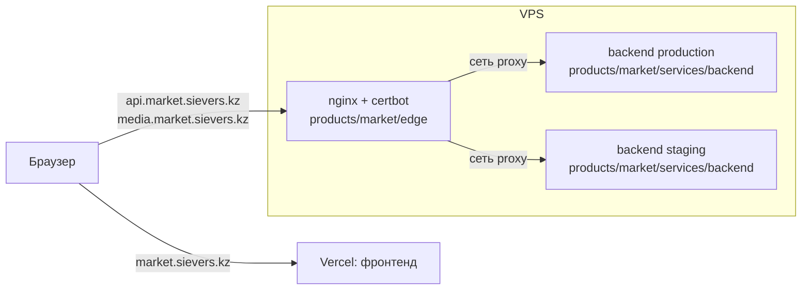

# sievers-infra

Инфраструктура продуктов Sievers как код: reverse proxy, сертификаты, описание сервисов в Docker Compose и деплой на сервер через GitHub Actions. Сейчас здесь живёт один продукт, [Sievers Market](https://market.sievers.kz), его бэкенд и «край» (nginx и certbot).

Код сервисов лежит в своих репозиториях: [sievers-market-backend](https://github.com/sievers-kz/sievers-market-backend) и [sievers-market-frontend](https://github.com/sievers-kz/sievers-market-frontend). Здесь только то, что нужно, чтобы запустить их на сервере.

## Как это устроено
Production и staging бэкенда работают на одном VPS. Фронтенд на сервере не живёт: он развёрнут на Vercel и ходит к API по домену.



| Домен | Куда ведёт |
|---|---|
| `api.market.sievers.kz` | backend production |
| `api-test.market.sievers.kz` | backend staging |
| `media.market.sievers.kz`, `media-test.market.sievers.kz` | MinIO production и staging: браузер загружает и скачивает файлы по подписанным ссылкам |
| `market.sievers.kz`, `test.market.sievers.kz` | Vercel (production и staging фронтенда), на сервере только редирект с HTTP на HTTPS |
| `sievers.kz` | страница-заглушка холдинга |

Любой другой хост получает отказ (`444` на 80, отклонённое рукопожатие на 443).

## Структура репозитория
```
products/
  market/
    edge/                  nginx и certbot (Docker Compose)
      nginx/               nginx.conf, conf.d/*.conf по доменам, snippets
    services/
      backend/             стек бэкенда: docker-compose.yml и docker-compose.proxy.yml
.github/workflows/         CI и деплой
shared/scripts/            общие скрипты (пока пусто)
docs/                      документация (пока пусто)
```
Схема: `products/<продукт>/edge` для входной точки и `products/<продукт>/services/<сервис>` для каждого сервиса. В git нет папок «production» и «staging»: один compose-файл на сервис, а окружения различаются значениями из GitHub Environments.

## Edge: nginx и certbot
`products/market/edge/compose.yml` поднимает два контейнера.
- **nginx** принимает 80 и 443, терминирует SSL и проксирует запросы на бэкенды по имени в общей внешней Docker-сети `proxy`. Раз в 6 часов перечитывает конфигурацию, чтобы подхватывать обновлённые сертификаты.
- **certbot** каждые 12 часов запускает `certbot renew` в режиме webroot. Проверка домена идёт через `/.well-known/acme-challenge/`, который nginx отдаёт из общей папки.

Сертификаты хранятся на сервере в `/etc/letsencrypt`, в репозиторий не попадают. Выпущено два: один на `market.sievers.kz` вместе с поддоменами API, media и тестовыми, второй на `sievers.kz`.

Конфигурация в `conf.d` разбита по доменам. Для media отключена буферизация и увеличен лимит тела до 25 МБ: загрузка идёт прямым `PUT` от браузера в MinIO, а подпись ссылки привязана к хосту, поэтому nginx передаёт исходный `Host`.

## Стек бэкенда
`products/market/services/backend` описывает всё, что нужно одному окружению: бэкенд (FastAPI), воркер ARQ, PostgreSQL, Redis, MinIO и Meilisearch. База, Redis, MinIO и Meilisearch видны только внутри сети самого стека. В сеть `proxy` попадают лишь бэкенд и MinIO через `docker-compose.proxy.yml`, и только с алиасом окружения (`PROXY_ALIAS`), поэтому production и staging не пересекаются по имени. У каждого контейнера задан лимит памяти, у основных сервисов есть healthcheck.

Пример переменных окружения лежит в `products/market/services/backend/.env.example`. Реальные значения в репозиторий не коммитятся (`.env*` в `.gitignore`).

## CI и деплой
| Workflow | Когда запускается | Что делает |
|---|---|---|
| `ci.yml` | pull request в `main` | Проверяет конфигурацию nginx командой `nginx -t` в контейнере с временными самоподписанными сертификатами |
| `market-backend-deploy.yml` | вручную; его запускает `cd.yml` бэкенда после сборки образа | Выкатывает бэкенд выбранного окружения |
| `market-edge-deploy.yml` | push в `main` с изменениями в `products/market/edge/**`, либо вручную | Выкатывает nginx и certbot |

### Деплой бэкенда
1. Репозиторий бэкенда собирает образ, публикует его в GHCR с тегом `staging-<sha>` или `production-<sha>` и запускает `market-backend-deploy.yml` с окружением и тегом.
2. Workflow проверяет, что тег подходит окружению (`staging-` для staging, `production-` для production, затем 40 символов SHA).
3. Копирует compose-файлы на VPS и записывает `.env` из секрета окружения GitHub, подставляя `IMAGE_TAG`.
4. На сервере выполняет `docker compose config`, `pull` и `up -d --wait` с таймаутом 120 секунд: если контейнер не стал healthy, деплой считается неудачным. Старые образы чистятся.

Деплои одного окружения не идут параллельно (`concurrency`).

### Деплой edge
Копирует файлы на VPS, проверяет конфигурацию (`docker compose config` и `nginx -t` в контейнере) и только после этого поднимает контейнеры и пересоздаёт nginx.

### Окружения и секреты
Workflow работают через GitHub Environments: `market-backend-staging`, `market-backend-production` и `market-edge-production`. В них хранятся адрес и пользователь сервера (`DEPLOY_HOST`, `DEPLOY_USER`, `DEPLOY_PATH` как переменные), SSH-ключ (`DEPLOY_SSH_KEY`) и для бэкенда содержимое `.env` (`ENV_FILE`) как секреты. Подтверждение перед выкладкой настраивается в самом окружении.

## Работа с репозиторием
Ветка `main` защищена: изменения только через pull request, обязательна проверка «Nginx config test». Конфигурация nginx правится здесь, а не на сервере: следующий деплой перезапишет ручные правки.
